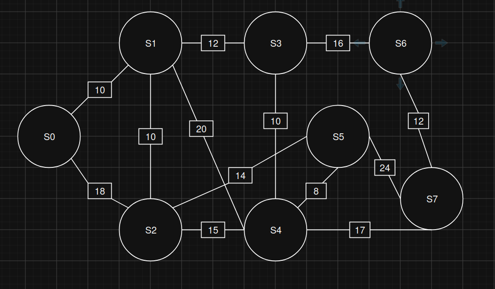

## 1° Etapa - Modelagem da matriz de pesos
- 6 primeiros números: 510230
- Parametrizaão do com base no RA:
    - D1: 5
    - D2: 1
    - D3: 0
    - D4: 2
    - D5: 3
    - D6: 0

- O destino decidido com base em D6, sendo um número par, é S7

### Tabela de Pesos calculados com base no RA:

| Aresta | Ramal | Fórmula do Peso w(e) | Resultado |
|--------|-------|----------------------|-----------|
| e1 | (S0, S1) | w1 = 10 + (0 mod 5)  | 10 |
| e2 | (S0, S2) | w2 = 15 + (3 mod 7) | 18 |
| e3 | (S1, S2) | w3 = 8 + (2 mod 4) | 10 |
| e4 | (S1, S3) | w4 = 12 + (0 mod 6) | 12 |
| e5 | (S2, S4) | w5 = 14 + (1 mod 5) | 15 |
| e6 | (S2, S5) | w6 = 9 + (5 mod 6) | 14 |
| e7 | (S3, S4) | w7 = 7 + ((3 + D6) mod 5) | 10 |
| e8 | (S3, S6) | w8 = 11 + ((2 + D5) mod 6) | 16 |
| e9 | (S4, S5) | w9 = 6 + ((0 + D4) mod 4) | 8 |
| e10 | (S4, S7) | w10 = 16 + ((1 + D3) mod 7) | 17 |
| e11 | (S5, S7) | w11 = 18 + ((5 + D2) mod 8) | 24 |
| e12 | (S6, S7) | w12 = 9 + ((3 + D1) mod 5) | 12 |
| e13 | (S1, S4) | w13 = 20 + (0 mod 4) | 20 |

### Grafo com pesos

### Matrix de peso 8x8:
| | S0 | S1 | S2 | S3 | S4 | S5 | S6 | S7 |
|----|----|----|----|----|----|----|----|----|
| S0 | 0 | 10 | 18 | ∞ | ∞ | ∞ | ∞ | ∞ |
| S1 | 10 | 0 | 10 | 12 | 20 | ∞ | ∞ | ∞ |
| S2 | 18 | 10 | 0 | ∞ | 15 | 14 | ∞ | ∞ |
| S3 | ∞ | 12 | ∞ | 0 | 10 | ∞ | 16 | ∞ |
| S4 | ∞ | 20 | 15 | 10 | 0 | 8 | ∞ | 17 |
| S5 | ∞ | ∞ | 14 | ∞ | 8 | 0 | ∞ | 24 |
| S6 | ∞ | ∞ | ∞ | 16 | ∞ | ∞ | 0 | 12 |
| S7 | ∞ | ∞ | ∞ | ∞ | 17 | 24 | 12 | 0 |

### Simétria e Esparsidade:

| | S0 | S1 | S2 | S3 | S4 | S5 | S6 | S7 |
|----|----|----|----|----|----|----|----|----|
| S0 | - | Conectado | Conectado | ∞ | ∞ | ∞ | ∞ | ∞ |
| S1 | Conctado | - | Conectado | Conectado | Conectado | ∞ | ∞ | ∞ |
| S2 | Conectado | Conectado | - | ∞ | Conectado | Conectado | ∞ | ∞ |
| S3 | ∞ | Conectado | ∞ | - | Conectado | ∞ | Conectado | ∞ |
| S4 | ∞ | Conectado | Conectado | Conectado | - | Conectado | ∞ | Conectado |
| S5 | ∞ | ∞ | Conectado | ∞ | Conectado | - | ∞ | Conectado |
| S6 | ∞ | ∞ | ∞ | Conectado | ∞ | ∞ | - | Conectado |
| S7 | ∞ | ∞ | ∞ | ∞ | Conectado | Conectado | Conectado | - |

&emsp; Com base na tabela acima que mostra os vertices que estão conectados ou não, podemos ver que sim ele apresenta simétria e esparsidade, pelo fato de haver menos da metade de conexões máximas possíveis. 

## 2° Etapa - Teste de mesa Tabular de Dijkstra

Origem: S0 | Destino: S7 | Os valores entre colchetes indicam vértices já fechados.

| Iteração | u | L[u] | L[S0] | L[S1] | L[S2] | L[S3] | L[S4] | L[S5] | L[S6] | L[S7] | Antecessores atualizados |
|----------|---|------|-------|-------|-------|-------|-------|-------|-------|-------|--------------------------|
| Inic. | — | — | 0 | ∞ | ∞ | ∞ | ∞ | ∞ | ∞ | ∞ | Inicialização na origem S0 |
| 1 | S0 | 0 | [0] | 10 | 18 | ∞ | ∞ | ∞ | ∞ | ∞ | Ant[S1] = S0, Ant[S2] = S0 |
| 2 | S1 | 10 | [0] | [10] | 18 | 22 | 30 | ∞ | ∞ | ∞ | Ant[S3] = S1, Ant[S4] = S1 (S2 mantido: 10 + 10 = 20 > 18) |
| 3 | S2 | 18 | [0] | [10] | [18] | 22 | 30 | 32 | ∞ | ∞ | Ant[S5] = S2 (S4 mantido: 18 + 15 = 33 > 30) |
| 4 | S3 | 22 | [0] | [10] | [18] | [22] | 30 | 32 | 38 | ∞ | Ant[S6] = S3 (S4 mantido: 22 + 10 = 32 > 30) |
| 5 | S4 | 30 | [0] | [10] | [18] | [22] | [30] | 32 | 38 | 47 | Ant[S7] = S4 (S5 mantido: 30 + 8 = 38 > 32) |
| 6 | S5 | 32 | [0] | [10] | [18] | [22] | [30] | [32] | 38 | 47 | Nenhum (S7 mantido: 32 + 24 = 56 > 47) |
| 7 | S6 | 38 | [0] | [10] | [18] | [22] | [30] | [32] | [38] | 47 | Nenhum (S7 mantido: 38 + 12 = 50 > 47) |
| 8 | S7 | 47 | [0] | [10] | [18] | [22] | [30] | [32] | [38] | [47] | Destino fechado, fim do algoritmo |

**Caminho mínimo:** S0 → S1 → S4 → S7, com custo total 10 + 20 + 17 = **47**.
